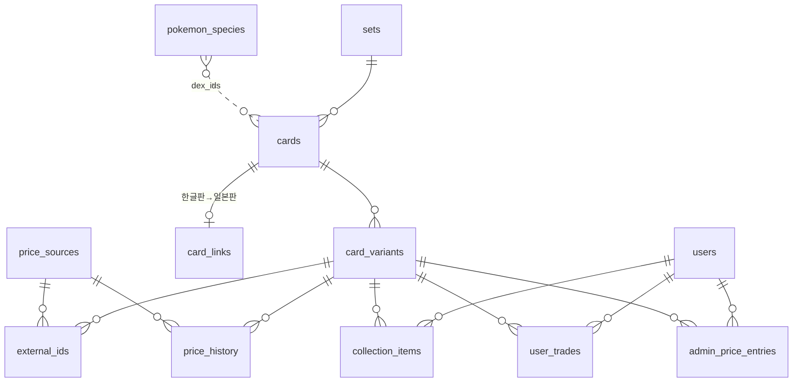

# Task #4 최종 결과보고서: DB 스키마 설계 및 마이그레이션

> **작성일**: 2026-11-06
> **브랜치**: `local/task4`
> **마일스톤**: M050 (v0.5.0)

## 개요

#2의 데이터 소스와 #3의 도구(goose, sqlc + pgx v5)를 바탕으로 13개 테이블을 설계했다. 설계는 실제 데이터 양과 실행 계획을 측정해 정했고, goose 마이그레이션 3개로 만들었다. 금액 Go 타입은 `shopspring/decimal`로 정했고, 수집기와 API가 바로 쓸 기본 쿼리 17개와 생성 코드를 추가했다.

이제 백엔드와 수집기는 시작할 때 13개 테이블을 만들고, `dbq` 패키지로 카탈로그·가격·환율·사용자 데이터를 저장하고 조회할 수 있다. #5·#6은 수집 로직만 작성하면 된다.

## 수행 결과

| 단계 | 내용 | 커밋 |
|------|------|------|
| 계획 | 수행 계획서, 구현 계획서 (1단계 커밋에 포함) | `5f351d8` |
| 1단계 | 요구 사항 33건 추적표, 엔터티·ERD 초안, 결정 사항 D1~D6 (열거 값·기본 키·이력 형태 등), Q1~Q4 결정 | `5f351d8` |
| 2단계 | DDL 상세 정의, 실제 데이터 양 측정, 이력 형태별 크기 측정, 대표 쿼리 8개 실행 계획, Q5·Q6 결정 | `cde5cdc` |
| 3단계 | 마이그레이션 `00002`~`00004`, 테스트 DB 헬퍼, 마이그레이션 왕복·제약 테스트, `TEST_DATABASE_URL` | `96662e0` |
| 4단계 | 금액 Go 타입 비교·결정, sqlc overrides, 기본 쿼리 17개와 생성 코드, 쿼리 테스트, 문서 갱신 | `bc226c9` |

## 산출물

### 테이블 (13개)



| 마이그레이션 | 테이블 |
|--------------|--------|
| `00002_catalog.sql` | `sets`, `cards`, `card_variants`, `card_links`, `pokemon_species` (+ `pg_trgm` 확장) |
| `00003_prices.sql` | `price_sources`(초기 5행), `external_ids`, `price_history`, `fx_rates` |
| `00004_users.sql` | `users`, `collection_items`, `user_trades`, `admin_price_entries` |

`fx_rates`는 다른 테이블과 관계가 없어 그림에서 뺐다. 컬럼·제약 정의는 `mydocs/tech/db_schema.md` 6절에 있다.

### 주요 설계 결정

| 항목 | 결정 | 근거 |
|------|------|------|
| 가격 이력 형태 | 넓은 형태 (변형·소스·소스 기준일마다 1행, 가격 필드는 컬럼) + 대표값 `price`·`price_basis` | 하루 약 13만 8천 행, 1년 약 10 GB. 필드마다 1행인 긴 형태는 같은 정보에 약 28 GB |
| 파티셔닝 | 하지 않음 | 조회가 기본 키 범위 스캔이거나 날짜 하루치만 읽는다. 과거 이력 채우기(#6)나 보존 기간 연장 시 다시 판단 |
| 열거 값 | `text` + `CHECK`. 가격 소스만 참조 테이블 | `enum` 값은 지울 수 없어 마이그레이션 `Down`과 맞지 않는다 |
| 기본 키 | `bigint identity`. `users`는 `uuidv7()`, `price_sources`는 `smallint` | 가입자 수 노출 방지. 이력 행마다 바이트 절약 |
| 가격 성격·통화 | `price_sources`에 둔다 | 소스마다 하나로 정해진다. 가격 행에 두면 소스와 어긋날 수 있다 |
| 원 가격 보존 | 원래 통화 그대로 저장, 원화 환산은 조회 시 | 일본판 참고가도 저장하지 않는다 (Q3) |
| 사용자 거래가·관리자 입력가 | 원본 테이블 + 시세 값만 `price_history` | 시세 조회를 한 테이블로 통일 |
| 금액 Go 타입 | `shopspring/decimal` v1.6.0 | Go에서 정확한 산술이 가능하고, pgx 어댑터가 필요 없다 |
| NULL 표현 | 모두 포인터 | 생성 코드에 `pgtype` 없음 |

### 작업지시자 결정 사항

| # | 결정 |
|---|------|
| Q1 | TCGdex `ko`에 없는 한글판은 카드 행을 만들지 않고 일본판 카드에 `has_ko_edition` 표시 |
| Q2 | 가격 이력의 날짜는 소스 기준일 |
| Q3 | 일본판 참고가는 저장하지 않고 조회 시 환산 (**#2 방침 변경**, #7 A안이 조회 쿼리가 됨) |
| Q4 | 컬렉션 기간별 증감은 현재 보유 수량 기준 |
| Q5 | 한글 이름 검색용 `pokemon_species` 테이블 추가 (데이터 적재는 #5) |
| Q6 | 상태 등급은 TCGplayer 5단계, 감정 카드는 다루지 않음 |

### 사용 방법

```go
q := dbq.New(pool)

// 카탈로그 (같은 키로 다시 저장하면 같은 ID, 값 갱신)
setID, _ := q.UpsertSet(ctx, dbq.UpsertSetParams{Language: "ja", TcgdexID: "SV5K", Name: "ワイルドフォース"})

// 가격 이력 일괄 저장 (pgx 배치, 같은 변형·소스·날짜는 갱신)
q.UpsertPriceHistory(ctx, rows).Exec(func(i int, err error) { /* 행별 오류 */ })

// 환율: 그날 값이 없으면 직전 값
fx, _ := q.GetFxRateOnOrBefore(ctx, dbq.GetFxRateOnOrBeforeParams{BaseCurrency: "USD", QuoteCurrency: "KRW", Provider: "frankfurter", OnDate: day})
```

```bash
# Docker/ 에서
docker compose exec backend go tool sqlc generate   # 쿼리 변경 후 생성 코드 갱신 (생성 코드도 커밋)
docker compose exec backend go test ./...           # DB 테스트는 ${POSTGRES_DB}_test 에서 (없으면 자동 생성)
```

## 발견 사항

- **한글 이름 검색 공백**: Q1 결정 후 한글 이름이 있는 카드는 239장뿐이라 `피카츄` 검색이 0건이었다. Q5로 종 이름 테이블을 추가했다.
- **실제 데이터 양**: TCGCSV는 두 카테고리 전체(682개 그룹)에서 하루 변형 75,060행(상품 포함 상한)이다. TCGdex Cardmarket은 가격이 카드 단건 조회에만 있어, 하루에 약 3만 6천 회를 요청해야 한다(#6 부담). TCGCSV 일본판은 `marketPrice` NULL이 21.6%라 대표값 대체 규칙이 필요하다.
- **보조 인덱스 효과**: 급등 순위 쿼리가 174 ms에서 24 ms로 줄었다(30일치 기준). 대신 1년에 약 1.9 GB를 더 쓴다.
- **PostgreSQL `enum`**: 값을 지울 수 없고, goose 트랜잭션 안에서 추가한 값은 같은 마이그레이션에서 쓸 수 없다.
- **`ON DELETE RESTRICT` 위반은 SQLSTATE `23001`**이다. 외래 키 위반 `23503`과 다르다(#10 오류 처리).
- **의존성 버전 충돌**: decimal을 v1.4.0으로 고정하자 goose가 v3.28.0으로 내려가, 최신 v1.6.0을 썼다.
- **sqlc override 이름**: `pg_catalog.timestamptz`는 무시되고 `timestamptz`로 써야 적용된다.
- **decimal은 끝자리 0을 버린다** (`0.20` → `0.2`). 화면 표시 형식은 #8에서 맞춘다.
- **CRLF**: Windows 체크아웃(`core.autocrlf=true`) 때문에 컨테이너의 `gofmt -l`이 모든 파일을 나열한다. CR을 지우면 차이가 없다. 이번 타스크 이전부터 있던 상태이다.

## 검증

| 항목 | 결과 |
|------|------|
| 빌드 (`go build ./...`, `go vet ./...`) | ✅ |
| 단위 테스트 (`go test ./...`) | PASS 30 (하위 테스트 포함), FAIL·SKIP 0 |
| 마이그레이션 왕복 | 빈 DB → up(13개 테이블) → 버전 0까지 down(테이블 0개, 확장 삭제) → up ✅ |
| 제약 | 잘못된 행 14종 거부, 초기 데이터·UUID 버전·연쇄 삭제 확인 ✅ |
| 쿼리 | 다시 저장해도 행 수·ID 유지, 기간 조회 날짜순, 환율 직전 값, 이메일 대소문자 무시 ✅ |
| sqlc 재생성 | 생성 파일 6개 해시 동일 ✅ |
| 개발 환경 재현 | DB 볼륨 삭제 후 `up -d --build` → 마이그레이션 1~4 적용, `/healthz` `{"db":"ok","status":"ok"}` ✅ |
| 회귀 | 기존 server·scheduler 테스트 통과, 없음 |

## 계획 대비 차이

| 계획 | 실제 | 사유 |
|------|------|------|
| 가격 이력 긴 형태 (1단계 잠정안) | 넓은 형태 | 2단계 측정에서 긴 형태가 약 2.8배 컸다 |
| 테이블 12개 | 13개 (`pokemon_species`) | Q5 결정 |
| 2단계 테이블별 컬럼 표 | DDL을 정의로, 판단 근거만 표 | 표와 DDL이 어긋나는 것을 막기 위해 |
| 테스트 DB `pokecard_test` | `${POSTGRES_DB}_test` (기본 `cardmarket_test`) | `.env`의 DB 이름 하나로 관리 |
| 테스트 DB 생성 방법 (초기화 스크립트 또는 헬퍼) | 테스트 헬퍼가 `CREATE DATABASE` | 초기화 스크립트는 볼륨을 처음 만들 때만 실행된다 |
| 재현성 확인 `docker compose down -v` | DB 볼륨만 삭제 | `-v`는 Go·npm 캐시 볼륨까지 지운다 |
| 일본판 참고가 저장 (#2 방침) | 조회 시 환산 | Q3 결정 |

## 후속 조치

- **이슈 #7 본문 수정 완료** (작업지시자 승인, 2026-11-06): (A) 일본판 참고가를 "원화로 환산해 저장"에서 "조회할 때 `fx_rates`로 환산, 저장하지 않음"으로 고쳤다 (Q3 결정).
- 후속 타스크(#5~#10) 인계 사항은 `mydocs/tech/db_schema.md` 10절 마지막 표에 정리했다.

## 이슈

- https://github.com/Chocobone/PokeCardPrice/issues/4
