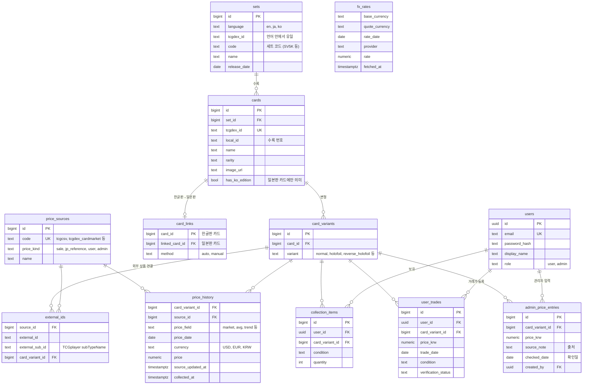

# 기술 조사: DB 스키마 설계

> **작성일**: 2026-11-06
> **관련 타스크**: [#4](https://github.com/Chocobone/PokeCardPrice/issues/4) DB 스키마 설계 및 마이그레이션
> **상태**: 1단계(요구 사항·엔터티·결정 사항) 승인. 상세 정의와 규모 추정은 2단계에서 추가한다.

---

## 배경

#2에서 정한 데이터 소스(TCGdex, TCGCSV, Frankfurter, 국내 A·B·C안)와 #3에서 정한 도구(goose, sqlc + pgx v5, PostgreSQL 18)를 바탕으로 테이블을 설계한다.
1단계에서는 요구 사항을 한곳에 모아 엔터티로 옮기고, 상세 설계를 좌우하는 결정 사항을 정한다.

- 확인 환경: PostgreSQL 18.6 (`postgres:18-alpine3.24`), 인코딩 UTF8, `en_US.utf8`, sqlc v1.31.1. 확인일 2026-11-06
- 확인용 DB: 임시 데이터베이스 `poc_task4` (2단계 종료 후 삭제)

## 조사 내용

### 1. 요구 사항 추적표

반영 위치의 테이블 이름은 3절 엔터티 초안 기준이다.

| # | 출처 | 요구 | 반영 위치 | 비고 |
|---|------|------|-----------|------|
| R1 | #4 | 세트 | `sets` | |
| R2 | #4 | 카드 | `cards` | |
| R3 | #4 | 가격 소스 | `price_sources` | 참조 테이블 (4절 D1) |
| R4 | #4 | 날짜별 시세 이력 | `price_history` | |
| R5 | #4 | 가격 성격 구분 (실거래·호가·판매가) | `price_sources.price_kind` | 가격 성격은 소스마다 하나로 정해진다 (4절 D5) |
| R6 | #4 | 환율 | `fx_rates` | |
| R7 | #4 | 사용자 | `users` | 인증 관련 추가 컬럼·테이블은 #9 |
| R8 | #4 | 컬렉션 | `collection_items` | |
| R9 | #4 | 시계열 조회용 인덱스 | `price_history` 인덱스 | 2단계에서 대표 쿼리로 확정 |
| R10 | #2 | 카드 언어 (`en`, `ja`, `ko`) | `sets.language` | 카드는 세트의 언어를 따른다. 검색 필터용 비정규화 여부는 2단계 |
| R11 | #2 | TCGdex 카드 ID | `cards.tcgdex_id` | 카탈로그 원천이라 카드에 직접 둔다 |
| R12 | #2 | TCGplayer `productId`+`subTypeName` 복합 키 | `external_ids (external_id, external_sub_id)` | 변형 단위로 연결 |
| R13 | #2 | Cardmarket 상품 ID | `external_ids` | 변형 단위로 연결 |
| R14 | #2 | 가격 이력: 카드 변형 단위 | `price_history.card_variant_id` | |
| R15 | #2 | 가격 이력: 소스, 통화, 원 가격, 가격 필드 종류 | `price_history` 컬럼 | 통화는 `USD`·`EUR`·`KRW` |
| R16 | #2 | 가격 이력: 소스 갱신일, 수집일 | `price_history.price_date`, `collected_at` | 유일 키에 쓰는 날짜는 2단계에서 확정 (5절 Q2) |
| R17 | #2 | 가격 성격 값 4종 (`판매가`, `참고가(일본판 환산)`, `사용자 등록가`, `관리자 입력가`) | `price_sources.price_kind` CHECK | |
| R18 | #2 | 환율: 통화쌍, 값, 값 기준일, 제공처 | `fx_rates` 컬럼 | |
| R19 | #2 | 사용자 거래가: 사용자, 카드, 가격(KRW), 거래일, 상태 등급, 검증 상태 | `user_trades` | |
| R20 | #2 | 판매자 정보 컬럼 없음 | 해당 컬럼 없음 | |
| R21 | #5 | 한글판 → 일본판 연결 (자동 매칭 실패 시 수동 연결) | `card_links` | 연결 방법(`auto`·`manual`) 기록 |
| R22 | #5 | TCGdex `ko`에 없는 한글판은 "한글판 존재"만 표시 | `cards.has_ko_edition` (일본판 카드) | 5절 Q1 |
| R23 | #6 | 소스 갱신일이 오래된 가격은 현재가로 표시하지 않음 | `price_history.price_date` 비교 | 판단 기준(며칠)은 #6·#8 |
| R24 | #6 | 환율 값이 없으면 직전 값 사용 | `fx_rates (base, quote, rate_date)` 인덱스 | 조회 쿼리에서 처리 |
| R25 | #7 | 일본판 참고가를 원화로 환산 | 조회 시 `price_history`(일본판 변형) × `fx_rates`로 계산 | Q3 결정: 저장하지 않음 (2026-11-06) |
| R26 | #7 | 관리자 입력가: 가격·출처·확인일 | `admin_price_entries` | 원본 입력 테이블 (4절 D5) |
| R27 | #7 | 사용자 거래가 집계 결과 | `price_history` (소스 `user_aggregate`) | 원본은 `user_trades` |
| R28 | #8 | 이름·세트·번호 검색 | `cards.name` trigram 인덱스, `cards (set_id, local_id)` | 4절 D6 |
| R29 | #8 | 7일·30일·90일·1년 추이, 변동률, 급등락 순위 | `price_history` 인덱스 | 2단계 |
| R30 | #10 | 보유 카드·수량 | `collection_items` | |
| R31 | #10 | 총 평가액, 기간별 증감 | `collection_items` × `price_history` 계산 | 현재 보유 수량 기준. 보유 이력은 저장하지 않음 (5절 Q4) |
| R32 | #9 | 비밀번호 해시 저장 | `users.password_hash` | 해시 방식은 #9 |
| R33 | #7 | 관리자만 관리자 입력가 등록 | `users.role` | 권한 검사는 #9 |

**반영하지 않는 요구**

| 요구 | 사유 | 담당 |
|------|------|------|
| 토큰·세션 저장 | 인증 방식 미정 | #9 (필요 시 마이그레이션 추가) |
| 조회 결과 캐시, 순위 집계 테이블 | 성능 측정 후 판단 | #11 |

### 2. 엔터티 초안 (ERD)

- 컬럼은 엔터티 구분에 필요한 것만 적었다. 생성·수정 시각, NULL 허용, 기본값, 제약은 2단계 상세 정의에서 정한다.
- `price_history`, `fx_rates`의 기본 키(대리 키를 둘지, 유일 키를 기본 키로 쓸지)는 2단계에서 정한다.

### 3. 엔터티별 설명

| 엔터티 | 역할 | 주요 설계 판단 |
|--------|------|----------------|
| `sets` | 언어별 세트 | TCGdex 세트 ID는 언어마다 체계가 달라 `(language, tcgdex_id)`로 유일하게 한다. 한글판·일본판 연결에 쓸 세트 코드를 따로 둔다 |
| `cards` | 카드 | 수록 번호는 `SV5K-001`, `TG01`처럼 숫자가 아닐 수 있어 `text`로 둔다 |
| `card_variants` | 가격의 기준 단위 | TCGdex `variants_detailed`는 문서에 없는 필드라, 변형을 외부 필드에 묶지 않고 자체 코드로 둔다. 외부 상품과는 `external_ids`로 연결한다 |
| `card_links` | 한글판 → 일본판 연결 | 한글판 카드 1장당 연결 1개. 자동 매칭이 틀리면 수동으로 바꿀 수 있도록 방법을 기록한다. 영어판과는 연결하지 않는다(#2 결론) |
| `price_sources` | 가격 소스와 가격 성격 | 이름·가격 성격·출처 표기 문구처럼 속성이 있어 참조 테이블로 둔다 |
| `external_ids` | 소스별 외부 상품 ID | TCGplayer는 `productId` + `subTypeName`, Cardmarket은 상품 ID. 같은 외부 상품이 두 변형에 연결되지 않게 `(source_id, external_id, external_sub_id)`를 유일하게 한다 |
| `price_history` | 날짜별 가격 | 원래 통화와 원래 값 그대로 저장한다. 원화 환산은 `fx_rates`로 조회할 때 계산한다 |
| `fx_rates` | 환율 | 값 기준일과 제공처를 함께 저장한다. 1차 Frankfurter, 대체 한국수출입은행 |
| `users` | 사용자 | 최소 컬럼만 둔다. `role`은 관리자 입력가 권한 구분용이다 |
| `collection_items` | 보유 카드 | 같은 카드 변형·상태 등급은 한 행에 수량으로 관리한다 |
| `user_trades` | 사용자 거래가 원본 | 사용자 소유 데이터이고 검증 상태가 바뀌므로 `price_history`와 분리한다. #7이 집계해 `price_history`에 넣는다 |
| `admin_price_entries` | 관리자 입력가 원본 | 출처·확인일·입력자를 남긴다. 시세로 쓰는 값은 `price_history`에도 넣어, 조회 쿼리가 소스 종류와 상관없이 같은 테이블을 읽게 한다 |

### 4. 결정 사항 비교

#### D1. 열거 값 표현

`poc_task4`에서 세 방식에 값 1개를 추가하고 되돌리는 작업을 해 보았다. 샘플 테이블은 20만 행이다.

| 확인 항목 | PostgreSQL `enum` | `text` + `CHECK` | 참조 테이블 (FK) |
|-----------|-------------------|------------------|------------------|
| 값 추가 | `ALTER TYPE ... ADD VALUE`. 트랜잭션 안에서 실행은 되지만 **커밋 전에는 새 값을 쓸 수 없다** (`unsafe use of new value`). goose는 기본으로 마이그레이션마다 트랜잭션을 쓰므로, 값 추가와 사용을 다른 마이그레이션으로 나눠야 한다 | 제약 삭제 후 다시 추가. 20만 행에서 10.7 ms(`NOT VALID` + `VALIDATE` 방식 11.9 ms) | `INSERT` 1행 |
| 값 삭제 (`Down`) | **불가** (`dropping an enum value is not implemented`). 타입을 다시 만들고 컬럼을 바꿔야 한다 | 제약을 이전 목록으로 되돌리면 된다 | `DELETE`. 쓰이는 값이면 FK가 막아 준다 |
| 잘못된 값 거부 | 됨 | 됨 | 됨 |
| 정렬 | 정의 순서로 정렬된다 | 문자열 순 | 문자열 순 (정렬 컬럼을 따로 둘 수 있음) |
| 한글 표시 이름 등 속성 | 둘 수 없음 | 둘 수 없음 | 컬럼으로 둘 수 있음 |
| sqlc 생성 타입 | `type PriceKind string`과 값 상수, `Scan`·`Valid`·`AllPriceKindValues`, `NullPriceKind`까지 생성 | `string` | `string` |

- sqlc는 참조 테이블 이름이 enum 이름과 겹치면(`price_kinds` 테이블과 `price_kind` 타입) `struct name conflicts with enum name` 오류로 생성을 멈췄다. 두 방식을 섞을 때는 이름을 다르게 지어야 한다.

**선정안**

- **값 목록이 짧고 거의 바뀌지 않는 값**(언어, 통화, 가격 성격, 상태 등급, 검증 상태, 사용자 역할, 연결 방법)은 **`text` + `CHECK`**로 한다. 되돌리기가 쉽고, goose 트랜잭션 제약이 없다.
- **속성이 있는 값**(가격 소스)은 **참조 테이블**로 한다.
- `enum`은 쓰지 않는다. 생성되는 Go 상수는 편하지만, 값을 되돌릴 수 없어 "모든 마이그레이션에 `Down`" 원칙과 맞지 않는다. 필요한 Go 상수는 4단계에서 직접 정의한다(값 몇 개 수준).

#### D2. 기본 키

| 대상 | 선정안 | 근거 |
|------|--------|------|
| 카탈로그·가격 (`sets`, `cards`, `card_variants`, `price_sources`, `price_history` 등) | `bigint generated always as identity` | 내부 조인이 많고 행 수가 가장 많은 `price_history`가 참조한다. 8바이트로 `uuid`(16바이트)보다 인덱스가 작다. 카드 ID가 URL에 노출되어도 문제가 없다 (공개 카탈로그) |
| `users` | `uuid`, 기본값 `uuidv7()` | 순번이 노출되면 가입자 수를 추정할 수 있다. PostgreSQL 18의 `uuidv7()` 동작을 확인했다 (`01a1afb2-9943-77c8-...`). 시간순이라 B-tree 삽입이 무작위 `uuid`보다 유리하다 |
| `collection_items`, `user_trades`, `admin_price_entries` | `bigint identity` | API에서 수정·삭제할 때 항상 사용자 소유 여부를 함께 조건으로 건다(#10) |

- sqlc는 `uuid`를 `pgtype.UUID`로 생성한다. `google/uuid`(이미 간접 의존성)로 바꿀지는 금액 타입과 함께 4단계 `overrides`에서 정한다.

#### D3. 가격 이력 형태

| 형태 | 내용 | 장점 | 단점 |
|------|------|------|------|
| **긴 형태** | `(변형, 소스, 가격 필드, 날짜)`마다 1행 | 소스마다 필드가 달라도(TCGCSV `low`·`mid`·`high`·`market`·`directLow`, Cardmarket `avg`·`low`·`trend`·`avg1`·`avg7`·`avg30`) 테이블이 같다. 필드를 추가해도 마이그레이션이 없다. #2 설계 입력(가격 필드 종류 컬럼)과 맞는다 | 필드 수만큼 행이 늘어난다. 행마다 헤더(약 24바이트)와 키 컬럼이 반복된다 |
| **넓은 형태** | `(변형, 소스, 날짜)`마다 1행, 필드별 NULL 허용 컬럼 | 행 수가 필드 수 분의 1. 빈 컬럼은 NULL 비트맵이라 거의 공간을 쓰지 않는다 | 소스 필드가 바뀌면 마이그레이션이 필요하다. 필드별 추이 조회 쿼리가 컬럼 이름에 묶인다 |

**잠정 선정안: 긴 형태.** 단, 행 수가 문제가 되면 **저장할 필드를 소스별 대표 필드로 줄이는 것**을 먼저 검토한다. 2단계에서 두 형태의 1년치 크기를 `poc_task4`에서 실제로 재서 확정한다.

#### D4. 금액 Go 타입 (sqlc `overrides`)

sqlc 기본 생성 결과: `numeric` → `pgtype.Numeric`, `date` → `pgtype.Date`, `timestamptz` → `pgtype.Timestamptz` (NULL 허용 여부와 상관없이 같은 타입).

| 후보 | 장점 | 단점 |
|------|------|------|
| `pgtype.Numeric` (기본) | 추가 의존성 없음, 정밀도 보존 | 산술 연산이 없다. JSON 직렬화와 비교·계산마다 변환이 필요하다 |
| `string` | 정밀도 보존, JSON에 그대로 쓸 수 있다 | 계산하려면 파싱해야 한다. 타입으로 금액임이 드러나지 않는다 |
| decimal 라이브러리 (`shopspring/decimal` + pgx 어댑터 등) | 정밀 산술(환산, 평균, 변동률), JSON 지원 | 의존성 추가 |

판단 기준: Go에서 하는 계산의 양(환산·집계를 SQL에서 할지 Go에서 할지), JSON 응답 형태, 의존성 수. **4단계에서 실제 생성 코드로 비교해 확정한다.**

DB 쪽 정밀도는 2단계에서 정한다. 현재 후보는 가격 `numeric(14,2)`(USD·EUR 센트 단위, KRW 정수), 환율 `numeric(18,8)`이다.

#### D5. 가격 성격·사용자 거래가·관리자 입력가의 위치

| 결정 | 선정안 | 근거 |
|------|--------|------|
| 가격 성격 | `price_sources.price_kind`에 둔다 | 확정 소스마다 가격 성격이 하나다(TCGCSV·Cardmarket → 판매가, 일본판 환산 → 참고가, 사용자 집계 → 사용자 등록가, 관리자 입력 → 관리자 입력가). 가격 행마다 반복하면 소스와 성격이 어긋나는 행이 생길 수 있다 |
| 사용자 거래가 | 원본은 `user_trades`, 집계 결과만 `price_history` | 원본은 사용자 소유이고 수정·삭제·검증 상태 변경이 있다. 시세 조회는 `price_history` 한 곳에서 한다 |
| 관리자 입력가 | 원본은 `admin_price_entries`, 시세 값은 `price_history` | 출처·확인일은 관리자 입력에만 있는 정보라, `price_history`에 NULL 컬럼을 늘리지 않는다. 사용자 거래가와 같은 구조(원본 → 시세)로 맞춘다 |

#### D6. 카드 이름 검색

`poc_task4`에서 `pg_trgm` GIN 인덱스로 한글·영어·일본어 이름을 검색했다.

- 확장 설치 가능 (`postgres:18-alpine3.24`에 포함).
- `ILIKE '%상해%'`가 인덱스(`Bitmap Index Scan`)를 사용했고 `이상해씨`, `이상해풀`을 찾았다. `'%리자%'` → `리자몽 ex`, `'%char%'` → `Charizard`.
- 한글 두 글자 검색어는 trigram을 만들 수 없어 인덱스가 걸러 주지 못하고, 인덱스 전체를 읽는다. 표본이 5행이라 성능은 판단하지 못했다. **2단계에서 카드 수 규모로 확인한다.**

**선정안**: `pg_trgm` GIN 인덱스. 확장 생성은 `00002_catalog.sql`에 넣는다.

### 5. 작업지시자 확인 사항

**Q1~Q4 모두 제안대로 결정 (작업지시자, 2026-11-06).**

| # | 사항 | 제안 | 영향 |
|---|------|------|------|
| Q1 | TCGdex `ko`에 없는 한글판 카드(전체의 약 97.5%)를 카드 행으로 만들지 | **만들지 않는다.** 일본판 카드에 `has_ko_edition`만 표시한다(#2 설계 입력과 같음). `ko`에 있는 239장만 한글판 카드 행으로 만들고 `card_links`로 일본판에 연결한다 | #5 범위, #13 화면 (한글판 카드는 대부분 일본판 카드 페이지로 보이게 됨) |
| Q2 | `price_history` 유일 키의 날짜를 **소스 기준일**로 할지 **수집일**로 할지 | **소스 기준일.** 소스가 갱신되지 않은 날 수집해도 같은 행이 갱신될 뿐 새 행이 생기지 않고, 오래된 가격을 날짜로 바로 알 수 있다. 수집 시각은 `collected_at`에 따로 남긴다 | #6 적재 로직, #8 추이 차트 (소스가 갱신되지 않은 날은 빈 날짜가 된다) |
| Q3 | 일본판 참고가(#7 A안)를 KRW로 **저장**할지, **조회할 때 계산**할지 | **조회할 때 계산한다.** 일본판 가격(USD·EUR)은 이미 `price_history`에 있고, 환산은 `fx_rates`로 언제든 다시 할 수 있다. 저장하면 같은 정보를 두 번 갖게 되고, 환율을 고치면 다시 계산해야 한다. API는 계산 결과를 가격 성격 `참고가(일본판 환산)`로 표시한다 | **#2에서 정한 "환산해 저장" 방침을 바꾸는 것**. 승인되면 #7 A안은 저장 작업 대신 조회 쿼리가 되고, `price_sources`에 `jp_reference` 행은 표시용으로만 남긴다 |
| Q4 | 컬렉션 기간별 증감(#10)을 **현재 보유 수량 기준**으로 계산할지 | **현재 보유 수량 기준**으로 계산한다(현재 수량 × 날짜별 가격). 보유 이력 테이블은 두지 않는다 | 카드를 언제 샀는지를 반영한 손익은 계산할 수 없다. 필요하면 #10에서 `acquired_at`·매입가 컬럼을 추가한다 |

## 결론

1. 테이블은 12개로 나눈다: `sets`, `cards`, `card_variants`, `card_links`, `price_sources`, `external_ids`, `price_history`, `fx_rates`, `users`, `collection_items`, `user_trades`, `admin_price_entries`.
2. 열거 값은 `text` + `CHECK`로, 가격 소스는 참조 테이블로 한다. `enum`은 값을 되돌릴 수 없어 쓰지 않는다.
3. 기본 키는 `bigint identity`로 하고, `users`만 `uuidv7()`로 한다.
4. 가격 이력은 긴 형태를 잠정 선정했다. 2단계에서 크기를 재서 확정한다.
5. 금액은 DB에서 `numeric`이다. Go 타입은 4단계에서 정한다.
6. 사용자 거래가와 관리자 입력가는 원본 테이블에 두고, 시세로 쓰는 값만 `price_history`에 넣는다.
7. Q1~Q4는 제안대로 결정되었다 (2026-11-06). Q3에 따라 일본판 참고가는 저장하지 않고 조회할 때 환산하며, #7 A안은 조회 쿼리로 바뀐다.

## 적용 방향

- 2단계: Q1~Q4 결정을 반영해 테이블별 컬럼·제약·인덱스를 확정하고, 가격 이력 규모를 `poc_task4`에서 측정한다.
- 3단계: 마이그레이션 파일 `00002_catalog.sql`, `00003_prices.sql`, `00004_users.sql`

## 참고 자료

- PostgreSQL 18 문서: `ALTER TYPE` (https://www.postgresql.org/docs/18/sql-altertype.html), UUID 함수 (https://www.postgresql.org/docs/18/functions-uuid.html), `pg_trgm` (https://www.postgresql.org/docs/18/pgtrgm.html)
- goose 트랜잭션 비활성화 주석 `-- +goose NO TRANSACTION`: https://pressly.github.io/goose/documentation/annotations/
- `mydocs/tech/price_data_sources.md` "소스 확정안", "후속 타스크 설계 입력" 절
- `mydocs/tech/domestic_price_sources.md` "국내 거래가 대체 방안" 절
- `mydocs/tech/backend_stack.md` sqlc 기본 타입 메모
